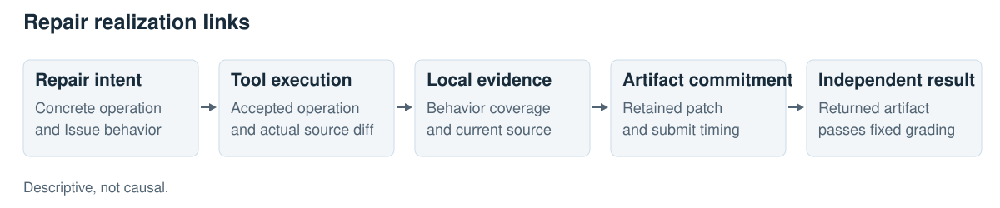
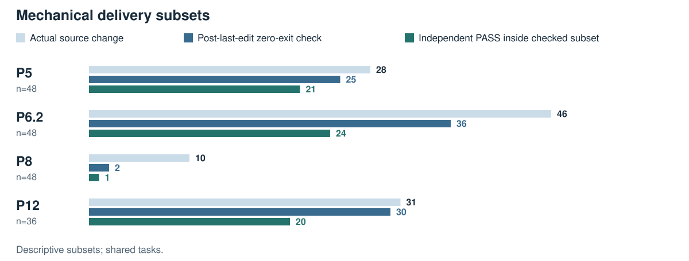
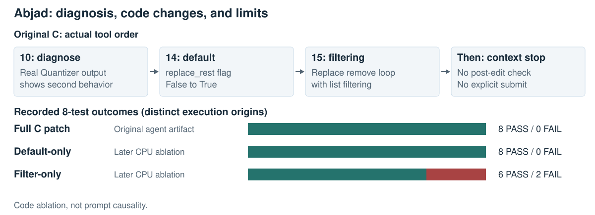

# From Local Improvement to Verified Repair: A Cross-Intervention Delivery Audit

**Subtitle:** Source-bound evidence, three-state check replay, and an exploratory prompt-only test

**Artifact repository:** [https://github.com/ymping666/evidence-is-not-a-patch](https://github.com/ymping666/evidence-is-not-a-patch)

## Abstract

A check evaluates one source state; a coding agent is judged on the patch it eventually returns. We operationalize this evidence-to-artifact gap across four historical interventions: 180 episodes, 2,451 tool events, and 21 distinct tasks. Of 549 recorded checks, 213 inspect production source differing from the final artifact. Holding checks and fixtures fixed, we replay 314 qualified original/candidate/reference triples (942 executions). Among failing candidates with zero-exit checks, all three source states also exit zero in 16/16, 14/19, 16/21, and 36/36 units across panels. This is **exit-status non-discrimination**, not proof that output carries no information. Meanwhile, selective edit supervision improves validation loss by 31.5% but changes recorded repairs from 12/24 to 11/24. A separate 72-run, locally prespecified prompt-only test yields 6/24 repairs against baseline 5/24, with no stable gain. We provide source-bound measurements, three-state discrimination tests, and provenance-separated patch ablations that make local evidence and final delivery auditable.

## 1. Introduction

Repository-repair systems range from tool-rich SWE-agent [1] to structured Agentless [2], yet are scored on delivered patches [3]. A check can inspect obsolete source, fail to distinguish wrong from correct code, or validate an edit absent from the final artifact. Prior patch research establishes that passing tests need not imply correctness [4]; benchmark audits reveal additional evaluation defects [5]. We examine a different gap: whether local execution evidence applies to the code ultimately delivered.

We ask: **Which source did a check inspect? Can the same check distinguish source states? Did a useful edit survive handoff?** We bind evidence to reconstructed source hashes, replay fixed checks on three states, and inspect delivery counterexamples across interventions. A separate prompt-only test probes this chain without identifying component causality.

**Figure 1. Repair-chain audit map.** Links are descriptive; correct supplied candidates may bypass editing. This is not a causal decomposition.

## 2. Paired interventions and outcomes

The scaffold is Henao's Budget-Fit Single Agent V5 [6], deploying Gemma-4-31B QAT. Historical complete-agent panels generally allow eight minutes, 28 counted tools, 80 turns, and 8,192 output tokens. P8 instead refines supplied candidates with eight additional tools, twelve model requests, and 480 seconds. Historical seeds were uncontrolled; P120 fixes its seed. Panels are paired within protocol, not interchangeable randomized arms.

| Panel and intervention | Intermediate result | Complete-agent outcome |
| --- | --- | --- |
| P5: selective edit SFT | Validation NLL 0.2670 → 0.1828 (−31.5%) | BASE 12/24; LoRA 11/24 |
| P6.2: feedback prompt | Exploration BASE 12/16; FB 13/16 | Frozen confirmation: 13/24 each |
| P8: candidate checking | 32 independent-check outputs; zero passed the format gate or executed | R/G/D: 4/16, 4/16, 3/16 |
| P12: native-history exclusion / smaller thinking budget | Input tokens −35.9% / −27.4% | BASE/NH4096/NH1024: 7/12, 7/12, 6/12 |
| P120: locally prespecified prompt-only SEAL | Contract/evidence/closure instructions; no weight update | A 5/24; B 5 PASS + 1 UNKNOWN; C 6/24 |

**Table 1. Local objectives and repairs.** Counts retain scheduled attempts, including P5's twelve UNKNOWN scores. P8 measures supplied-candidate preservation. NLL validation and feedback exploration are outside the 180-episode corpus. P120's 72 runs are separate; its original and adjudicated results appear in Section 6.

**Selective supervision.** A rank-16 adapter learns first source-edit calls from public OpenHands trajectories (212 units/97 tasks training; 19 units/10 tasks validation), split by task and repository. NLL covers 6,888 target tokens including format and edit context. BF16-dequantized training deploys in QAT. Twelve development tasks repeated twice yield two favorable and three unfavorable flips; this does not assess SFT generally.

**Feedback prompting.** Guidance separates invalid probes from implementation defects. Confirmation on twelve other development tasks repeated twice gives two wins and two losses; repeat-level advantage reverses.

**Candidate checking.** Eight frozen candidates (six incorrect, two correct) enter refinement-only R, generated-check G, and discriminator-oriented D twice each. All 32 G/D outputs fail formatting; no independent check executes. The eleven passes preserve correct inputs, ten without new edits and one after restoration; no incorrect input is repaired. Scheduling deviations limit timing comparisons.

**Native history.** NH4096 omits past thoughts; NH1024 additionally caps new thinking at 1,024 tokens. Neither uses learned summarization. Input savings raise output tokens without rescuing BASE failures; NH1024 loses Pyflakes. Each arm has three timeouts; cross-hardware efficiency remains untested.

## 3. From interventions to a mechanical delivery audit

The event-level audit (E1) fixes P5/P6.2/P8/P12 at 48/48/48/36 episodes over 12/12/8/12 tasks, respectively: 21 distinct identities, with overlap and repeats. We report panels separately; tasks and repeats are dependent.

We reconstruct production-source changes from diffs and tool feedback, including `write_file` and source-modifying `run_command`, not just `edit_file`. For every check, the audit binds its execution order, source hash, check/fixture identity, and outcome to a separately reconstructed final-source hash. All 180 final production-source states match archived delivery under documented reconstruction assumptions; loaded-module identity is unverified.

The first measurable break is **source drift**: 213/549 checks (38.8%) inspect source different from the final artifact; among 161 episodes with checks, fifteen last-check states differ. This is a temporal mismatch, not proof that the old evidence was useless.

Our strict local condition requires an executed check exiting zero **after the last actual production-source change**; within-command ordering matters. This asserts that a qualifying zero-exit event exists, not that the last check passed or the issue was fixed. An earlier zero exit cannot validate a later version.

| Panel | Actual new source change | Independent PASS / FAIL / UNKNOWN | FAIL among changed episodes | FAIL after last-change zero-exit |
| --- | --- | --- | --- | --- |
| P5 | 28 | 23 / 13 / 12 | 5/28 | 4/25 |
| P6.2 | 46 | 26 / 22 / 0 | 20/46 | 12/36 |
| P8 | 10 | 11 / 37 / 0 | 9/10 | 1/2 |
| P12 | 31 | 20 / 16 / 0 | 11/31 | 10/30 |

**Table 2. Mechanical events and original independent outcomes.** The last column conditions on actual source change, a subsequent qualifying zero-exit check, and a valid final score. P8's inherited-candidate preservation bypass is essential: no new edit need be appropriate for an already-correct candidate.

**Figure 2.** Nested descriptive subsets—source change, a qualifying later zero exit, and independent PASS—not necessary steps for every success. P8's one PASS inside the change branch restores an already-correct input. The broader any-after-change failure counts, 4/25, 14/38, 4/5, and 10/30, remain appendix diagnostics; especially P8's 4/5 must not replace the strict 1/2.

## 4. Three-state discrimination and temporal alignment

The three-state audit (E4) asks whether an unchanged agent-written check distinguishes **original buggy code, the final agent candidate, and reference repair**. Command, check body, auxiliary fixtures, and qualified environment remain fixed; only the source changes. Identities include hashes and the complete candidate patch. Source hashes before fixtures, after fixtures, and after checking guard against accidental candidate mutation. Invalid application, missing inputs, and environment failures are UNKNOWN.

Before replay outcomes, 318 candidate-conditioned units yield 314 eligible triples covering 408 events/130 episodes; four lack consistent fixtures. All 942 executions qualify. Safely recoverable checks are overrepresented.

| Panel | Candidate exit=0 / failed-candidate units | All-three-zero / candidate-zero units | Failed episodes covered | Post-last-change candidate-zero / historical events |
| --- | --- | --- | --- | --- |
| P5 | 16/20 (80.0%) | 16/16 (100%) | 8/13 | 9/9 |
| P6.2 | 19/28 (67.9%) | 14/19 (73.7%) | 11/22 | 12/16 |
| P8 | 21/29 (72.4%) | 16/21 (76.2%) | 23/37 | 0/1 |
| P12 | 36/45 (80.0%) | 36/36 (100%) | 16/16 | 20/20 |

**Table 3. Candidate-conditioned exit-status discrimination.** Units deduplicate check/fixture/candidate/environment identities within panel. The all-three-zero column conditions further on candidate exit=0: 36/36 in P12 means all thirty-six zero-exit checks also return zero on original and reference, not thirty-six additional episodes. Reference nonzero outcomes do not remove candidates from the first denominator. Repeated tasks and checks remain dependent.

The matrix reveals **candidate-conditioned status blindness**: many failed candidates share a zero exit with original and reference source. Printed errors may still differ; one behavior can pass while another fails. Four P12 units instead exit nonzero on the candidate but zero on original/reference.

Table 3's last column uses event weighting and restricts to checks **historically after the last source change**. These are new-environment reexecutions, not model-visible feedback. Small denominators and P8's frequent candidate preservation preclude agent-misjudgment estimates.

Event-weighted and fixture-excluded sensitivity counts are released in the statistical supplement; they do not imply complete historical-workspace recovery. New-environment independent labels change only P5 to 20/24 units; original UNKNOWN scores remain.

These measurements separate source drift from exit-status non-discrimination. Neither alone establishes that a check is behaviorally irrelevant, and the qualified replay subset must not be extrapolated to all historical checks.

## 5. Bounded source-state and commitment cases

The source-state case audit (E2) scores twenty qualified tasks: 166 new final scores agree in all 154 cases with comparable valid original labels, while fourteen Selfies episodes remain unqualified; 149/153 intermediate attempts score validly. P5 Billiard creates and later loses a passing intermediate patch. P8 OpenAPI instead reverts an initially supplied correct patch. Three captured self-checks from these cases exit zero on both passing and failing states, although printed output may differ. These demonstrate existence, not failure rates.

The budget-denied-edit replay (E3) distinguishes **workspace repair from submission**. P6.2 Pyflakes rejects an edit because `old_string` is absent. In P12 Pyflakes, a denied edit would yield a 25/25 test-passing workspace patch, but it occurs at step 32, 34.21 seconds *after* `submit_patch` at step 31. The submitted 238-byte patch contains only a reproduction script. The official runner returns that existing snapshot; no resubmission or end-to-end counterfactual delivery was executed. Thus extra edit allowance is not a demonstrated rescue.

## 6. Prospective exploratory SEAL intervention

SEAL (Specification-grounded Evidence and Artifact Locking) changes only `system.md`: A is exact BF_V5; B adds Stop & Seal budget/closure guidance; C additionally requests an issue-grounded contract and final-source evidence. Weights, tools, and scaffold are fixed. Tasks, prompts, seed 20261018, contrasts, and UNKNOWN handling were hash-locked locally *before* main runs, not publicly preregistered. Six exposed engineering smokes were excluded; their scores did not select prompts.

Twenty-four repositories each receive A/B/C: **72 new generations**, no historical outputs reused. Arms share GPU/profile; six arm orders repeat four times. Limits: 480 seconds, 28 tools, 80 turns, 8,192 output and 4,096 thinking tokens, temperature/top-p 0.2/0.95. Tasks comprise 22 reused DEV and two TRAIN-origin candidates with no exposure in a bounded scan, **not** 24 fresh heldout tasks.

Original outcomes are A: 5 PASS/19 FAIL; B: 5 PASS/18 FAIL/1 UNKNOWN; C: 6 PASS/18 FAIL. C versus A has one win, no losses (unadjusted exact discordant p=1.0); C versus B has prespecified net bounds of 0-1 repair. All arms fail both project-unexposed candidates. The sole flip, Abjad, is reused DEV; there is no stable gain.

B's Marshmallow collection error remains UNKNOWN in the primary record. Later CPU controls attribute it to a candidate-added double-`cls` call; removing that exception is not a repair. Separate assistant adjudication labels B FAIL, yielding A/B/C totals of 5/5/6, but still only **71 valid original scores**, not 72.

In Abjad, C executes a repository example for the second reported behavior, interprets its output, then changes a constructor default and replaces mutation-during-iteration with filtering. A/B also discuss that behavior, but A implements only filtering and B retains debugging. A/B fail two default-value assertions; C passes eight tests. Post-hoc CPU ablations use the unchanged frozen scorer: default-only passes 8/8; filtering-only passes 6/8 and fails the same two constructor-default assertions. The default change alone reproduces C's test success. This isolates code contributions under existing tests, not prompt causality.

**Figure 3. Abjad evidence and patch ablation.** C's original agent artifact and the two later CPU ablations have distinct provenance. Only the default-value change is needed for the existing eight-test PASS; this does not identify prompt causality or broader correctness. C never performed post-edit verification or explicitly submitted.

No failing check occurs between C's two edits. C performs no post-edit check; all three arms exceed context and never explicitly submit. Its PASS is the returned workspace patch, not demonstrated final-verification or commitment success. This is an exploratory diagnosis-to-action case, with unfulfilled SEAL mechanisms.

## 7. Related work and scope of novelty

**Agent architectures and learning.** SWE-bench [3] evaluates repository repairs, while SWE-agent [1] designs tool interfaces and Agentless [2] structures localization, repair, and validation. SWE-Gym [7] trains repair agents and verifiers; SWE-Prime [8] selects trajectories. Our cross-intervention audit instead tests whether local progress reaches the final artifact.

**Testing and patch correctness.** Qi et al. [4] showed that test-plausible patches can be incorrect; TestGen-LLM [9] qualifies generated tests, and ExecCritic [10] separates test construction from repair. We instead ask whether an unchanged check distinguishes original, candidate, and reference code, and whether it inspected the version delivered.

**Feedback, replay, and reliability.** Reflexion [11] and Self-Refine [12] exploit language feedback; SWE-Replay [13] branches agent trajectories, unlike our fixed-source reexecution. Trajectory studies examine success/failure strategies [14], temporal failure processes [15], and submission-versus-resolution gaps [16]. Trial by Trace [17] audits harness reliability; SWE-Bench Pro Verified [5] addresses benchmark leakage and task defects. Our focus is version-bound check-to-artifact continuity, not a new failure taxonomy or proven repair method.

## 8. Limitations, artifacts, and conclusion

The historical panels share development tasks and differ in protocol; they do not establish cross-task generalization or the ineffectiveness of fine-tuning and verification. Replay relies on reconstructed source and qualified environments, with eligibility bias and possible probe-internal randomness. No cross-hardware timing or independence-based significance is claimed.

Targeted semantic inspection covered 148 assistant-inspected units, including 61 checks, and four deeper cases; there were **zero human confirmations**. Labels and supplementary counts are public.

The [public artifact](https://github.com/ymping666/evidence-is-not-a-patch) provides anonymized statistics, source hashes, Abjad patches, and CPU verification scripts. It excludes private tests, the task scorer, full snapshots, and raw trajectories. Statistical recomputation is not new agent execution; reproducing private test outcomes still requires unavailable scoring assets.

The result is a **source-bound audit protocol** that exposes separate breaks in source continuity, check discrimination, and artifact delivery. It turns an intuitive last-mile concern into inspectable measurements and concrete counterexamples. SEAL remains exploratory; future controlled studies must test whether repairing these breaks improves independent issue resolution.

## References

1. Yang, J., et al. (2024). [*SWE-agent: Agent-Computer Interfaces Enable Automated Software Engineering*](https://papers.nips.cc/paper/2024/hash/5a7c947568c1b1328ccc5230172e1e7c-Abstract-Conference.html). NeurIPS 37.
2. Xia, C. S., et al. (2025). [*Demystifying LLM-Based Software Engineering Agents*](https://doi.org/10.1145/3715754). Proc. ACM Softw. Eng. 2(FSE):801-824.
3. Jimenez, C. E., et al. (2024). [*SWE-bench: Can Language Models Resolve Real-World GitHub Issues?*](https://proceedings.iclr.cc/paper_files/paper/2024/hash/edac78c3e300629acfe6cbe9ca88fb84-Abstract-Conference.html). ICLR.
4. Qi, Z., Long, F., Achour, S., and Rinard, M. (2015). [*An Analysis of Patch Plausibility and Correctness for Generate-and-Validate Patch Generation Systems*](https://doi.org/10.1145/2771783.2771791). ISSTA, 24-36.
5. Zheng, P., et al. (2026). [*SWE-Bench Pro Verified: A Reliable Benchmark for Software Engineering Agents*](https://arxiv.org/abs/2609.08149). arXiv:2609.08149.
6. Henao, W. E. (2026). [*Gemma 4 Agent: Budget-Fit Single Agent*](https://www.kaggle.com/code/verracodeguacas/gemma-4-agent-budget-fit-single-agent?scriptVersionId=355310852) (Version 5). Kaggle Notebook.
7. Pan, J., et al. (2025). [*Training Software Engineering Agents and Verifiers with SWE-Gym*](https://proceedings.mlr.press/v267/pan25g.html). ICML, PMLR 267:47717-47737.
8. Zheng, D., et al. (2026). [*SWE-Prime: Fewer Trajectories, Better Performance*](https://arxiv.org/abs/2608.27449v1). arXiv:2608.27449.
9. Alshahwan, N., et al. (2024). [*Automated Unit Test Improvement using Large Language Models at Meta*](https://doi.org/10.1145/3663529.3663839). FSE 2024 Companion, 185-196.
10. Tao, L., et al. (2026). [*ExecCritic: Learn to Test, Test to Improve for Coding Agents*](https://arxiv.org/abs/2609.09133v1). arXiv:2609.09133.
11. Shinn, N., et al. (2023). [*Reflexion: Language Agents with Verbal Reinforcement Learning*](https://proceedings.neurips.cc/paper_files/paper/2023/hash/1b44b878bb782e6954cd888628510e90-Abstract-Conference.html). NeurIPS 36.
12. Madaan, A., et al. (2023). [*Self-Refine: Iterative Refinement with Self-Feedback*](https://proceedings.neurips.cc/paper_files/paper/2023/hash/91edff07232fb1b55a505a9e9f6c0ff3-Abstract-Conference.html). NeurIPS 36.
13. Ding, Y. and Zhang, L. (2026). [*SWE-Replay: Efficient Test-Time Scaling for Software Engineering Agents*](https://arxiv.org/abs/2601.22129v1). arXiv:2601.22129.
14. Majgaonkar, O., et al. (2025). [*Understanding Code Agent Behaviour: An Empirical Study of Success and Failure Trajectories*](https://arxiv.org/abs/2511.00197v1). arXiv:2511.00197.
15. Zhao, X., et al. (2026). [*Failure as a Process: An Anatomy of CLI Coding Agent Trajectories*](https://arxiv.org/abs/2607.09510v1). arXiv:2607.09510.
16. Mehta, A. (2026). [*Confident and Wrong: Silent Semantic Failures in Coding Agents*](https://arxiv.org/abs/2603.25764v3). arXiv:2603.25764.
17. Cao, Z., et al. (2026). [*Trial by Trace: Benchmarking AI Agent Harnesses for Reliability and Failure Attribution*](https://arxiv.org/abs/2610.32285v1). arXiv:2610.32285.
